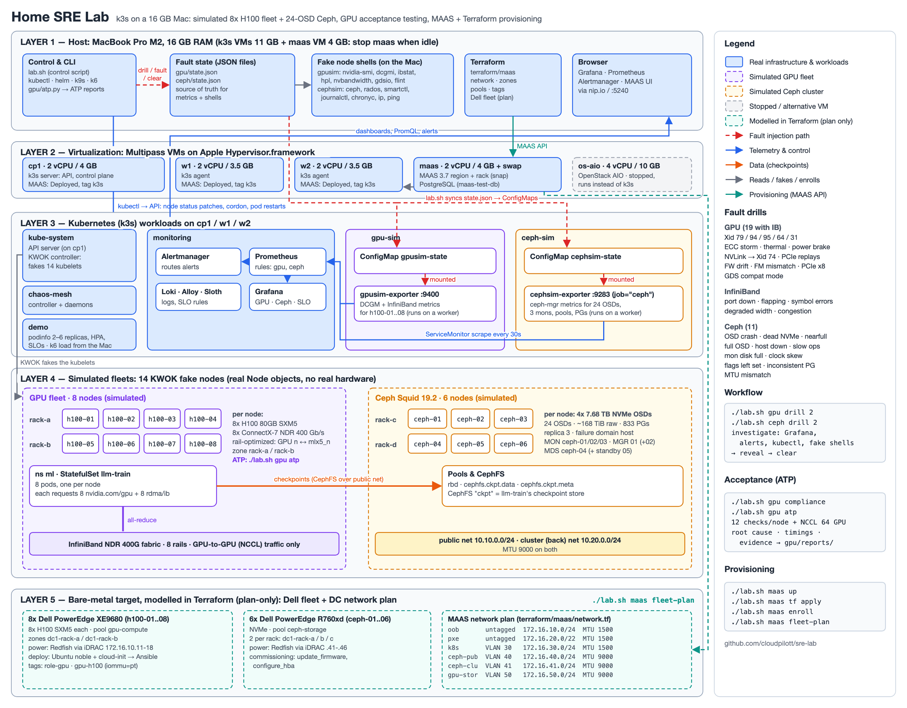

# SRE Lab — MacBook Pro M2 / 16 GB

A 3-node Kubernetes (k3s) cluster in Ubuntu VMs on your Mac, plus a working SRE toolchain:
metrics, logs, dashboards, SLOs with burn-rate alerts, chaos engineering and load testing. On top: a simulated
8x H100 GPU fleet and 24-OSD Ceph cluster for fault drills, GPU acceptance testing (ATP) against a locked build
standard, and a real MAAS controller driven by Terraform for bare-metal provisioning.



```
macOS (M2, 16 GB)
└── Multipass (QEMU + Apple Hypervisor.framework)
    ├── cp1  2 vCPU / 4 GB    k3s server (control plane + etcd/sqlite)
    ├── w1   2 vCPU / 3.5 GB  k3s agent
    ├── w2   2 vCPU / 3.5 GB  k3s agent
    │    ├── monitoring   Prometheus · Alertmanager · Grafana · Loki · Alloy · Sloth
    │    ├── chaos-mesh   Chaos Mesh controller + daemons + dashboard
    │    ├── demo         podinfo (2–6 replicas, HPA, ServiceMonitor, SLOs)
    │    └── gpu-sim / ceph-sim   exporters for the KWOK fake fleets (h100-01..08, ceph-01..06)
    └── maas 2 vCPU / 4 GB    MAAS 3.7 region + rack, configured by Terraform (optional)
```
The k3s VMs take ~11 GB, ~5 GB stays with macOS. The optional `maas` VM adds 4 GB: stop it when you're not using it.
Close heavy apps (Chrome, Docker Desktop) while the lab runs.

## Quick start

```bash
./lab.sh prereqs     # brew: multipass, kubectl, helm, k9s, k6
./lab.sh all         # ~15–25 min: VMs -> k3s -> platform -> demo app -> 'baseline' snapshot
./lab.sh status      # prints URLs
export KUBECONFIG=$PWD/kubeconfig
k9s
```

URLs use `nip.io` (wildcard DNS that maps `grafana.<ip>.nip.io` -> `<ip>`). If your network blocks it,
add the hostnames from `./lab.sh status` to `/etc/hosts`, or `kubectl port-forward` instead.

**macOS 15 note:** the first time, macOS may ask to allow your terminal to find devices on the
local network. Allow it, or `kubectl` cannot reach the VMs (System Settings → Privacy & Security → Local Network).

## Daily use
| Command | What it does |
|---|---|
| `./lab.sh stop` / `start` | Pause the VMs to get RAM and battery back |
| `./lab.sh tls` | Trusted HTTPS for all lab URLs (mkcert wildcard cert; run `mkcert -install` once, rerun if cp1's IP changes) |
| `./lab.sh snapshot before-drill` | Save a known-good state |
| `./lab.sh restore baseline` | Roll back after you broke something |
| `./lab.sh load` | k6 ramp to 50 VUs against podinfo |
| `./lab.sh chaos` | List chaos experiments; `./lab.sh chaos network-delay` runs one |
| `./lab.sh down` | Delete everything |

## Layout
```
lab.sh                 bootstrap + day-2 helper
values/                Helm values (sized for 16 GB)
slo/                   Sloth SLO definitions -> Prometheus burn-rate alerts
dashboards/            Grafana dashboards as ConfigMaps
chaos/                 Chaos Mesh experiments
load/                  k6 scripts
runbooks/              alert runbooks
gpu/                   simulated H100 fleet: gpusim.py, atp.py (acceptance tests), locked versions, thresholds, fixtures
ceph/                  simulated Ceph storage cluster: cephsim.py, k8s manifests, fault fixtures
maas/                  MAAS controller VM bootstrap + README
terraform/maas/        Terraform for MAAS: settings, zones, pools, network plan, tags, Dell fleet
docs/                  architecture diagram (make_architecture.py -> .svg -> .png)
EXERCISES.md           guided SRE drills
```

## Next layers (once the basics feel easy)
- **Argo CD**: move everything in `values/` to GitOps. Rebuild the lab from Git alone.
- **Argo Rollouts**: canary podinfo with an AnalysisTemplate that queries the SLO error ratio.
- **Tempo + OpenTelemetry Collector**: traces. The OpenTelemetry Demo is realistic, but it needs ~4 GB.
  Run it with chaos-mesh uninstalled, or give w1/w2 `W_MEM=4G`.
- **Velero + MinIO**: backup/restore drills.
- **Kyverno**: require limits, block `:latest`.
- **kubeadm rebuild**: redo the cluster with kubeadm + Cilium to practise cert rotation, etcd backup and upgrades.

## Simulated GPU fleet (8x H100 + InfiniBand)
Eight fake 8-GPU nodes join the k3s cluster through KWOK (a few MB of RAM, no real GPUs). A small exporter serves
DCGM and InfiniBand metrics, and a fake node shell prints realistic `nvidia-smi`, `dmesg`, `dcgmi`, `ibstat`, `perfquery`,
`ibdiagnet` and NCCL output. Inject GPU faults (Xid 79/94/95/64/31, ECC storms, thermal, power brake, NVLink, PCIe) and IB faults
(down, flapping, symbol errors, degraded width, congestion), or let `drill` pick a hidden one.

```bash
./lab.sh gpu up            # KWOK + h100-01..08 + exporter + alerts + dashboard + llm-train
./lab.sh gpu drill 1       # hidden fault + ticket; investigate, then: ./lab.sh gpu reveal
./lab.sh gpu ssh h100-03   # fake root shell on a GPU node (works even with the VMs stopped)
```
Details: `gpu/README.md`. Drills: EXERCISES.md level 5. Runbook: `runbooks/gpu-ib-faults.md`.

### GPU acceptance testing (ATP)
How a new or repaired node is proven before handover. The build standard is `gpu/locked-versions.json` (kernel, driver,
Fabric Manager, CUDA, DCGM, VBIOS, DOCA-OFED, HCA firmware, GDS, BIOS, iDRAC). Pass/fail targets are in `gpu/atp-thresholds.json`.
`gpu/atp.py` runs the real-style tools on each node and parses their output: versions, inventory, Fabric Manager,
`nvidia-smi topo -m`, PCIe width, ECC/row remap, InfiniBand, `dcgmi diag -r 3`, `nvbandwidth`, NCCL, HPL and GDS, plus a
64-GPU NCCL run. The report names the **root cause** per node, times every step and keeps the evidence.

```bash
./lab.sh gpu fault pcie-downtrain h100-02 3   # deployment faults: fw-drift, fm-mismatch, pcie-downtrain, gds-compat
./lab.sh gpu compliance    # locked-version check only (~1-2 min modelled)
./lab.sh gpu atp           # full ATP -> gpu/reports/atp-<time>.md + .json + .prom; exit 1 on any defect
```
Drills: EXERCISES.md level 7.

## Simulated Ceph storage (6 hosts, 24 NVMe OSDs)
Six fake storage hosts join the cluster through KWOK (no real Ceph: that needs 3-4 GB more RAM). An exporter serves
ceph-mgr metrics, and a fake admin shell prints realistic `ceph -s`, `ceph health detail`, `ceph osd df`, `rados`,
`smartctl`, `journalctl` and network output. CephFS `ckpt` is the GPU fleet's checkpoint store. Faults: OSD crash, dead NVMe,
nearfull/full OSD, host down, mon disk full, clock skew, maintenance flags left set, slow ops, inconsistent PG, MTU mismatch.

```bash
./lab.sh ceph up           # 6 storage nodes + exporter + alerts + dashboard
./lab.sh ceph drill 1      # hidden fault + ticket; investigate, then: ./lab.sh ceph reveal
./lab.sh ceph ssh          # fake admin shell on ceph-01 (works even with the VMs stopped)
```
Details: `ceph/README.md`. Drills: EXERCISES.md level 6. Runbook: `runbooks/ceph-faults.md`.

## Bare-metal provisioning: MAAS + Terraform
How the hardware under all of this would be built in a data centre: Terraform declares the machines and network,
MAAS powers servers on over Redfish (iDRAC), PXE-boots and commissions them, and deploys Ubuntu with cloud-init,
handing over to Ansible. Here MAAS 3.7 (region + rack) runs for real in the `maas` VM, and Terraform (`canonical/maas`
provider) configures it: settings, DNS domain, rack zones, resource pools, fabrics/VLANs/spaces/subnets with reserved and
PXE ranges, and XPath hardware tags. A Mac can't PXE-boot servers, so the 14-server Dell fleet (8x XE9680, 6x R760xd) is
modelled in Terraform and shown with `plan`, and the k3s VMs are imported as already-deployed machines.

```bash
brew install hashicorp/tap/terraform
./lab.sh maas up            # maas VM + MAAS + admin user + API key (kept in .maas/, gitignored)
./lab.sh maas tf init && ./lab.sh maas tf apply
./lab.sh maas enroll        # import cp1 w1 w2 as Deployed machines (then tf apply tags them k3s)
./lab.sh maas fleet-plan    # what Terraform would do to the Dell fleet
./lab.sh maas status        # API, image import, machines;  ./lab.sh maas ui for the web UI
```
Known limit: MAAS can't store the k3s nodes' hardware inventory (flannel/cni0 nested subnets). Details: `maas/README.md`.

## OpenStack all-in-one (alternative to the k3s lab)
OpenStack 2026.2 via Kolla-Ansible in a 4th VM, `os-aio` (4 vCPU / 10 GB). Run it **instead of** k3s, not beside it.

```bash
./lab.sh stop                 # free the k3s VMs' RAM
./lab.sh openstack up         # create VM, network, install Kolla-Ansible
./lab.sh openstack deploy     # ~45 min: deploy + demo network, CirrOS image and test-vm
./lab.sh openstack status     # services, agents, servers, Horizon URL
```
Compute is emulated (`virt_type=qemu`; the M2 has no nested virtualization), so use tiny CirrOS guests.
Files: `openstack/aio.sh` (runs inside the VM), `openstack/globals.yml.tpl`.

---
© 2026 cloudpilott. All rights reserved. Personal portfolio project, not accepting contributions.
